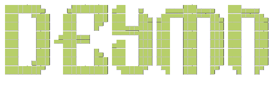

<p align="center">
  
</p>

<h1 align="center">DEYMN Omarchy Setup</h1>

<p align="center">A portable snapshot of my Omarchy 4.x desktop.</p>

This repo restores my desktop settings on another machine: **Spectra Bar**,
Hyprland and input settings, the DEYMN screensaver, wallpaper, idle/lock times
and Foot terminal settings. Tested on Omarchy 4.0.6 / Hyprland 0.56.2.

[Spectra Bar](https://github.com/itsw1n/spectra-bar) is included as a pinned Git
submodule, so you do not need to install it separately. See the
[Spectra workflow](docs/spectra-workflow.md) for updates.

## Quick start

Install Omarchy first and log into its desktop. Then run:

```bash
git clone --recurse-submodules https://github.com/itsw1n/Omarchy.git ~/Files/omarchy-setup
cd ~/Files/omarchy-setup
./install.sh --dry-run   # preview the changes
./install.sh             # install
```

If you already cloned the repo without submodules:

```bash
git submodule update --init --recursive
```

Requirements: Python 3, `jq`, Hyprland and the Omarchy 4 shell. No OS reinstall
or administrator privileges are needed. The installer copies the settings, so
the clone can be moved afterward.

## Install options

| Option | What it does |
| --- | --- |
| `--dry-run` | Show what would change without writing anything |
| `--monitors preserve` | Keep the destination machine's monitor setup (default) |
| `--monitors portable` | Detect connectors, use preferred resolution, auto-place, scale 1 |
| `--monitors deymn` | My laptop at 1.25x plus HDMI TV at 1x (hardware-specific) |
| `--no-apply` | Copy files only; apply theme and session at next login |
| `--home PATH` | Install into another home directory, e.g. for offline testing |
| `--restore PATH` | Restore a previous backup (backs up current config first) |
| `--spectra-dev PATH` | Link a separate Spectra checkout for bar development |
| `--spectra-copy` | Return to the saved Spectra copy after development mode |

The installer selects the saved theme and wallpaper, reloads Hyprland, validates
the config and rescans shell plugins. Spectra and shell settings hot-reload. If
you install outside a running desktop, log in again.

`packages.txt` lists the fonts and optional applications. Accounts and installed
apps are not part of this snapshot. The OpenCode and Typora shortcuts require
those apps; the OpenCode shortcut uses an installed Mise version in offline mode
and never installs or updates it at startup. Your terminal choice is preserved.

## What gets saved

| Path | Contents |
| --- | --- |
| `dotfiles/hypr/` | Lua overrides, display picker and TV scripts, night light and portal config |
| `dotfiles/omarchy/shell.json` | Spectra widgets/actions, 150s screensaver, 300s lock |
| `dotfiles/omarchy/plugins/itsw1n.spectra-bar/` | Pinned Spectra submodule; runtime and MIT license are copied on install |
| `dotfiles/omarchy/branding/`, `wallpapers/` | Personal artwork |
| `dotfiles/omarchy/hooks/` | Portable hooks that do not depend on this clone |
| `dotfiles/foot/` | Foot terminal settings only |
| `dotfiles/fastfetch/` | System-info layout and DEYMN ASCII logo |
| `profiles/` | Automatic and original-machine display profiles |
| `preferences.json` | Selected theme and wallpaper |

The installer merges these files into your config. Unrelated plugins, themes and
hooks are preserved. It only removes obsolete DEYMN hooks that patched branding
or overwrote configs on every boot, and detaches config folders previously linked
to this repo before writing.

## Screenshots

Screenshots of the desktop, bar and lock screen live in
[`docs/images/`](docs/images/README.md). Add new images there and list them in
that folder's index.

## Backups and rollback

Every install backs up `hypr`, `omarchy`, `foot` and `fastfetch` to
`~/.local/state/omarchy-setup/backups/<timestamp>/`. If copying or validation
fails, those folders are restored automatically.

To restore a backup manually:

```bash
./install.sh --restore ~/.local/state/omarchy-setup/backups/TIMESTAMP
```

Restoration backs up the current config first, then restores those four folders,
including files added since the backup. Log in again and reapply your previous
theme afterward. Theme-generated state and app colors are not rolled back.
Older seven-folder backups still work. Backups stay local and are never committed.

## Update this snapshot

After changing the desktop:

```bash
python3 scripts/capture.py
./install.sh --dry-run
git diff
```

Capture reads an explicit allowlist of settings. It does not copy Spectra or
change the pinned submodule. It saves the active wallpaper, theme name and local
theme overlays, and keeps the previous snapshot under
`~/.local/state/omarchy-setup/captures/`. It never collects credentials, Wi-Fi
profiles, browser data, applications or your whole home directory.

## Develop Spectra locally

For bar development, clone Spectra separately and link it:

```bash
./install.sh --spectra-dev ~/Files/spectra-bar
```

The bar then reads that folder through a symlink. Keep the folder in place and
reload the shell after code changes. Repeat installs keep the link. Run
`./install.sh --spectra-copy` to return to the saved copy.

Spectra edits do not update this repo automatically. After publishing changes,
follow the
[update workflow](docs/spectra-workflow.md#after-publishing-spectra-changes-maintainers)
to save the newer version here.

## Removed old setup

The old v3 installer, Waybar files, Hyprlock/Hypridle config, upgrade staging and
automatic Plymouth scripts were removed. They were backed up outside the repo,
and the last legacy version is preserved in the
[v1.0.0-omarchy3 release](https://github.com/itsw1n/Omarchy/releases/tag/v1.0.0-omarchy3).

Stock Aether shader symlinks were removed because they pointed at package-owned
system files; the installed shader files are untouched. Boot/login Plymouth
branding remains a manual customization, separate from the Quickshell lock screen.
Personal artwork stays in `assets/`. Night light remains off by default, and no
machine-specific Wi-Fi or upgrade scripts are applied.

See [CLEANUP.md](CLEANUP.md) for the checks and retained files.
